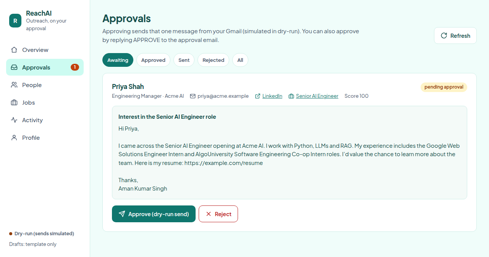

# ReachAI

**A local-first job-search outreach assistant that only sends what you approve.**

ReachAI finds recruiters and hiring managers at companies that are actively hiring for your target roles, drafts a short personalised message grounded in your real profile and a real job posting, and emails you each draft with **Approve** / **Reject** buttons. Nothing goes out until you approve it — and then only that one message is sent, from your own Gmail.

It runs on your laptop with SQLite, uses [Apollo.io](https://www.apollo.io/) for people data, Gmail for approvals and delivery, and [Claude Code](https://claude.com/claude-code) for drafting — no extra LLM API key needed.



---

## How it works

```text
Your profile ──► Apollo: people at companies hiring for your roles
                     │  (verified work email + matching live job posting only)
                     ▼
               Draft per person ── Claude Code (no tools) or template
                     │  fact checks: company, job title, resume link
                     ▼
               Approval email to you ── Approve & send / Reject / reply APPROVE
                     │
                     ▼
               Send that one message via Gmail ── daily limit, dedupe, audit log
```

1. **Find** — Apollo's free people search returns people with your chosen titles (recruiter, engineering manager, founder…) at companies with recent postings for your target roles.
2. **Qualify** — a person is kept only if Apollo has a *verified* work email for them and their company has a real posting matching one of your roles. Each lookup costs about one Apollo credit, capped per run.
3. **Draft** — Claude Code writes the message using only facts from your profile and the posting. If the result fails the fact checks, ReachAI falls back to a deterministic template.
4. **Approve** — you get one email per person with their LinkedIn, the job posting, and the exact message.
5. **Send** — approving sends that message from your Gmail. Everything is recorded in the audit log.

## Safety by design

- **Human approval is mandatory.** No message is sent without an explicit approval, and approving one message never approves another.
- **No fabrication.** Drafts may only use your profile and the stored job posting; targets are never invented.
- **Safe reply handling.** Only the first line *you* type in a reply counts, and only from your own address — quoted text can never approve a draft.
- **Limits enforced at send time.** Daily limit, blocked/already-contacted checks, email-level dedupe, and an atomic claim so a message can never be sent twice.
- **Dry-run by default.** Approval emails are real, but sends are simulated until you set `REACHAI_SEND_MODE=gmail`.
- **LLM is sandboxed.** Claude Code runs with every tool disabled, so untrusted data from Apollo can only influence text, never actions. It never sends anything itself.
- **Everything is local.** Your data, tokens and database stay on your machine; secrets live in git-ignored `.env` and `secrets/`.

## Quick start

Requires Python 3.11+.

```bash
git clone https://github.com/AmanSingh-tech/ReachAI.git && cd ReachAI
python3 -m venv .venv
.venv/bin/pip install -e . pytest
cp -n .env.example .env
.venv/bin/reachai serve        # dashboard at http://127.0.0.1:8000
```

The dashboard's **Overview** shows a setup checklist; complete it with the steps below.

## Setup

### 1. Your profile

Edit it in the dashboard (**Profile**) or in `data/candidate.json`:

- your real **email** (approval emails go here) and a **public resume link**
- **experience** — one line per role, accurate; drafts quote it
- **roles you want** (e.g. `AI Engineer, ML Engineer`) — companies hiring for these are searched
- **who to contact** (titles) and **companies to never contact**

### 2. Apollo

Create an API key in Apollo (Settings → Integrations → API). A master key is simplest; otherwise enable people search, people match and organization job postings. Add it to `.env`:

```bash
APOLLO_API_KEY=...
```

### 3. Gmail

1. In [Google Cloud Console](https://console.cloud.google.com/), create a project and enable the **Gmail API**.
2. Configure the OAuth consent screen (External) and add your Gmail address as a **test user**.
3. Create an **OAuth client ID** of type **Desktop app** and save the JSON as `secrets/credentials.json`.
4. Authorize once — a browser window opens:

```bash
.venv/bin/reachai auth-gmail
```

### 4. Drafting with Claude Code

ReachAI uses the `claude` CLI on your machine (`claude -p`, your existing login). It is found on `PATH` or inside the VS Code extension automatically; set `REACHAI_CLAUDE_BIN` to override. Prefer no LLM at all? Set `REACHAI_LLM_BACKEND=none` for template-only drafts.

## Daily use

**Dashboard** — `reachai serve`, then open <http://127.0.0.1:8000>:

| View | What it's for |
| --- | --- |
| Overview | Setup checklist, key numbers, **Find people now**, **Check email replies** |
| Approvals | Every draft with person, LinkedIn, job link and message; approve & send or reject |
| People | Everyone found or added; draft a message for anyone not yet contacted |
| Jobs | Postings that drafts refer to, with fit score |
| Activity | Audit trail of drafts, approvals, rejections and sends |
| Profile | The facts every draft is allowed to use |

**CLI**

```bash
reachai run              # find people, draft, and email you one approval per draft
reachai check-replies    # apply APPROVE / REJECT replies, then send what was approved
reachai daemon-start     # keep running: replies every minute, discovery once a day
reachai status           # counts, daily limit, what's pending
reachai find --max-enrich 5   # discovery only, with a credit cap
```

**Approving** — click **Approve & send** in the email (needs `reachai serve` running and reachable at `REACHAI_PUBLIC_URL`), click it in the dashboard, or simply reply to the approval email with `APPROVE` or `REJECT`.

## Configuration

All settings live in `.env` (see [`.env.example`](.env.example)).

| Variable | Default | Purpose |
| --- | --- | --- |
| `APOLLO_API_KEY` | — | Apollo people search and enrichment |
| `REACHAI_ENRICH_PER_RUN` | `10` | Max Apollo lookups (≈ credits) per run |
| `GMAIL_CREDENTIALS_PATH` | `./secrets/credentials.json` | OAuth client JSON |
| `GMAIL_TOKEN_PATH` | `./secrets/token.json` | Stored after `reachai auth-gmail` |
| `REACHAI_SEND_MODE` | `dry-run` | `dry-run` simulates sends; `gmail` sends for real |
| `REACHAI_DAILY_LIMIT` | `5` | Max messages sent per day |
| `REACHAI_LLM_BACKEND` | `claude-code` | `claude-code`, `openrouter` (needs `OPENROUTER_API_KEY`), or `none` |
| `REACHAI_CLAUDE_MODEL` | `sonnet` | Model used by Claude Code for drafts |
| `REACHAI_PUBLIC_URL` | `http://127.0.0.1:8000` | Where the email buttons point |
| `REACHAI_DB_PATH` | `data/reachai.db` | SQLite database |
| `REACHAI_CANDIDATE_PATH` | `data/candidate.json` | Your profile |

## Design system and UI skill

The dashboard follows a design system generated with the [UI UX Pro Max](https://github.com/nextlevelbuilder/ui-ux-pro-max-skill) skill (MIT): flat style, teal primary with an orange accent, Plus Jakarta Sans, light and dark modes, accessible contrast, visible focus states and reduced-motion support. The tokens and rules live in [`design-system/reachai/MASTER.md`](design-system/reachai/MASTER.md).

The skill itself is vendored in [`.claude/skills/ui-ux-pro-max`](.claude/skills/ui-ux-pro-max), so Claude Code picks it up automatically when you work on the UI in this repo. You can also query it directly:

```bash
python3 .claude/skills/ui-ux-pro-max/scripts/search.py "approval queue" --domain ux
```

## Project layout

```text
src/reachai/
  api.py            FastAPI app: dashboard + JSON API
  service.py        Workflow: discovery, drafting, approvals, replies, sending
  cli.py            `reachai` command
  daemon.py         Background loop (replies, sends, daily discovery)
  workers.py        Approval-reply parsing and the guarded send path
  integrations/     Apollo, Gmail, LLM (Claude Code / OpenRouter)
  skills/           Eligibility, scoring, research, personalization, critic, approval
  storage/          SQLite database and audit log
  static/index.html Dashboard UI
design-system/      Generated design system for the UI
site/               Static project website (deployable to Vercel)
docs/DESIGN.md      Original design specification
tests/              Test suite
```

## Project website

[`site/`](site/) is a static page that explains the project, shows how to set it up, and has a contact form. To deploy it on Vercel, import the repo, set **Root Directory** to `site` and **Framework Preset** to *Other* (no build command). The contact form posts to [Formspree](https://formspree.io/): create a form there and put its URL in the `data-endpoint` attribute of `#contact-form` in `site/index.html`.

## Development

```bash
.venv/bin/python -m pytest -q
```

Tests never call Apollo, Gmail or an LLM; external services are mocked.

API docs are available at <http://127.0.0.1:8000/docs> while the server runs.
